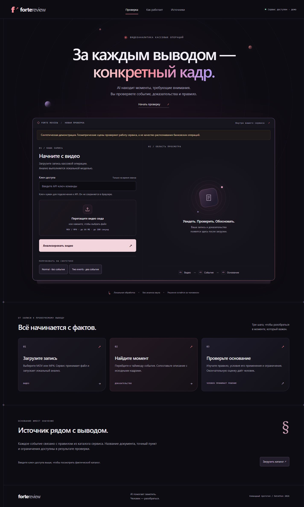

# Forte Review

A local video-review application for the ForteBank Datathon case. Upload a MOV file, poll the authenticated API, then inspect possible events with source frames, timestamps and a curated rule reference.

**Current model:** locally fine-tuned Qwen3-VL with a curated, local RK rule retriever. Bonsai is retained only as an earlier comparator. The public judge address is **https://fracture-freestyle-unvalued.ngrok-free.dev**. See [judge access and operations](docs/judges-handoff.md) and [Linux deployment](docs/linux-deployment.md). Model quality and deployment checks are separate; see the release results and limitations below.

## Final measured release

**18 October pre-submission upgrade check:** the newly downloaded 8B GGUF lacks a discovered matching vision projector and was not visually evaluated. The completed updated-annotation 2B adapter regressed on the same validation videos (F1 0.444 versus 0.667), so the published 2B release remains selected. The unchanged service was recovered and the longest real training MOV passed public HTTPS in 97.222 seconds. See [upgrade decision and recovery evidence](docs/qwen-upgrade-20261018.md) and [aggregate report](reports/qwen-upgrade-20261018.json).

Selected: **Qwen3-VL-2B-Instruct, four-epoch scene LoRA, BF16 inference and denser verification**, frozen in `configs/qwen-release.json`. Training used only 26 manually annotated training videos. A matched BF16 base-model control scored F1 0 on validation; the selected adapter scored 0.667.

| Evaluation | TP / TN / FP / FN | F1 | Accuracy | Failures |
|---|---:|---:|---:|---:|
| Validation, 7 videos | 2 / 3 / 1 / 1 | 0.667 | 5/7 (71.4%) | 0 |
| Held-out test, 7 videos, once after freeze | 2 / 0 / 3 / 2 | 0.444 | 2/7 (28.6%) | 0 |

**Generalization remains weak.** Every negative test clip was falsely flagged, and two positives were missed. The working application supports human review; these results do not support automatic compliance decisions. The seven-video validation set was used repeatedly for model selection. Actor accuracy, event classification, new-angle robustness and semantic timestamp correctness are unverified. Empty findings do not prove compliance.

See [complete results, methods and limitations](docs/release-results.md), [aggregate experiments](reports/qwen-experiments.json), [release/API evidence](reports/qwen-release.json), and the [short demonstration pitch](docs/pitch.md). Keep both the RTX laptop and its hotspot laptop awake and connected through **18 October 2026, 17:00 UTC+05**. Supply the URL and existing private key through the organizer's submission channel; no automatic submission has been made.

## Team resources

- [Hackathon plan and balanced 12-hour schedule](HACKATHON_PLAN.md)
- [Backend and deployment instructions](team/YOU_BACKEND.md)
- [Backend implementation and deployment handoff](docs/backend-handoff.md)
- [Ratmir's managed Linux deployment, commands and limits](docs/linux-deployment.md)
- [Ratmir: connect the prepared model to the backend](team/RATMIR_BACKEND_INTEGRATION.md)
- [Ratmir: ML and evaluation instructions](team/RATMIR_ML.md)
- [Amir: frontend and presentation instructions](team/AMIR_FRONTEND.md)
- [Download the complete team kit ZIP](https://github.com/amoe6a/datathon2026_tumo-astana/raw/refs/heads/main/team-kit/forte-review-team-kit.zip)
- [Verification report and remaining checks](TEST_REPORT.md)
- [Frontend handoff and browser checks](docs/frontend-handoff.md)
- [Ratmir: ML handoff, measurements and remaining work](docs/ml-handoff.md)
- [ML labeling guide](docs/ml-labeling.md)

Clone this repository to work together, or download the ZIP for a standalone copy. The source-only ZIP is rebuilt with `python -m scripts.build_team_kit`. Generate synthetic test clips locally with `python -m scripts.make_demo`. Real event videos, runtime evidence and credentials are not included. Use Git to receive later team changes.



## Start here

1. Read `HACKATHON_PLAN.md` for priorities and the 12-hour schedule.
2. Give everyone this entire folder or the ZIP, then their corresponding file in `team/`.
3. You: `team/YOU_BACKEND.md`. Ratmir: `team/RATMIR_ML.md`. Amir: `team/AMIR_FRONTEND.md`.
4. Run the synthetic demo on each laptop. Download and label event videos locally on the RTX laptop. Never upload event footage, frames or descriptions to Codex/cloud AI.
5. Integrate a measured real-data detector by hour 5; deploy and freeze by hour 10.

## Windows quick start

Install Python 3.11 and Git. In PowerShell opened in this folder:

```powershell
py -3.11 -m venv .venv
.venv\Scripts\python.exe -m pip install -r requirements.txt
.venv\Scripts\python.exe -m scripts.make_demo
$env:FORTE_API_KEY = .venv\Scripts\python.exe -c "import secrets; print(secrets.token_urlsafe(24))"
$env:FORTE_ENGINE = 'demo'
$env:FORTE_MODEL = 'models/demo.npz'
Write-Host $env:FORTE_API_KEY
.venv\Scripts\python.exe -m uvicorn app.main:create_app --factory --host 127.0.0.1 --port 8000 --workers 1
```

Open `http://127.0.0.1:8000`, enter the generated key, and choose **Normal** or **Two events**. These buttons generate real API uploads of synthetic MOV clips. Keep the terminal running. `run.ps1` automates the same steps; it defaults to explicitly labeled demo mode. Python 3.11 is the tested runtime. No Node installation is needed.

For macOS/Linux: `python3.11 -m venv .venv`, `.venv/bin/python -m pip install -r requirements.txt`; use `export FORTE_API_KEY=...`, `export FORTE_ENGINE=demo`, `export FORTE_MODEL=models/demo.npz`, and `.venv/bin/python` in place of the Windows interpreter path.

## Real baseline on CPU

Copy `data.example.json` to `data/manifest.json`. Put videos in `data/videos/`. Human labelers add a category and time interval for each visible event; the organizer's binary label alone is not enough. Use only reviewed categories from `rules/catalog.json`. Explicitly label normal intervals. Unlabeled frames are ignored. Group related recordings before splitting; keep camera/actor/session duplicates together.

Follow [the labeling guide](docs/ml-labeling.md) for the required `group_reviewed` and `events_reviewed` flags and complete event annotations. The manifest validator rejects unfinished review and leakage between splits. Ratmir's weak binary benchmark is an experimental comparator; its weights are rejected by the review API because they have no reviewed event types.

```powershell
.venv\Scripts\python.exe -m ml.train data/manifest.json --output models/reference.npz --threshold 0.8
.venv\Scripts\python.exe -m scripts.evaluate data/manifest.json --split val --output runtime/validation.json
$env:FORTE_ENGINE = 'reference'
$env:FORTE_MODEL = 'models/reference.npz'
```

Restart the server after changing its mode/model. The baseline uses small appearance, edge and motion features with a linear classifier. It is fast and useful as a measured comparator, but vulnerable to new camera angles and background shortcuts. Its scores are not calibrated probabilities. Synthetic weights are deliberately rejected in real reference mode.

## Qwen release on the RTX 4060 8 GB

The measured Linux runtime is separate from the Windows synthetic-demo environment. It uses local publisher Safetensors weights and a private supervised LoRA adapter trained only on the 26 training videos. The frozen configuration is `configs/qwen-release.json`; training/evaluation details are in [the Qwen report](docs/qwen-training-deployment.md).

On the configured RTX laptop:

```bash
cd /home/angel/forte-review-service
systemctl --user start forte-jury.service forte-ngrok.service
curl --fail http://127.0.0.1:8000/ready
```

Fresh-machine setup uses the exact Linux runtime lock, pinned publisher model revision, and selected adapter. See [deployment and rollback](docs/linux-deployment.md). Weights, video data, keys and private adapters are intentionally absent from Git and the team ZIP. A successful import is not an inference benchmark; verify a real MOV and the complete public upload path.

All inference stays local. Qwen observes actors/actions, a deterministic bilingual retriever selects source-backed rule cards, and a visual check applies their prerequisites and exceptions. Accepted events get actual source JPEGs and timestamps. Constrained JSON does not guarantee correct visual reasoning; known misses, false alarms and localization limitations must be reported honestly.

## Jury API

`POST /api/v1/analyze` accepts multipart field `file` and returns HTTP 202 with `job_id` and `status: processing`. `GET /api/v1/jobs/{job_id}` returns `processing`, `done` or `failed`. Both require the same `X-API-Key`. Success returns exactly the required verdict values and required event fields; optional rule/meta fields support the UI.

```powershell
curl.exe -X POST http://127.0.0.1:8000/api/v1/analyze -H "X-API-Key: $env:FORTE_API_KEY" -F "file=@data/demo/multiple.mov"
curl.exe http://127.0.0.1:8000/api/v1/jobs/REPLACE_WITH_JOB_ID -H "X-API-Key: $env:FORTE_API_KEY"
.venv\Scripts\python.exe -m scripts.smoke_api data/demo/multiple.mov
```

One job at a time prevents GPU overload; a second submission gets HTTP 429 with `Retry-After`. Ask the organizers whether their harness retries 429 or sends concurrent videos. If concurrency is required, you own adding tested capacity or queueing with a deadline measured from acceptance. Never silently queue jobs beyond the five-minute budget. Run **one** Uvicorn worker; an exclusive runtime lock rejects a second server using the same storage.

`GET /health` reports server liveness. `GET /ready` returns 200 only after the model loads and completes synthetic inference, otherwise 503; authenticated uploads also return 503 when not ready. Model/catalog changes require restart. Startup checks take up to `FORTE_READINESS_TIMEOUT` (90 seconds by default, maximum 120). Readiness proves that the engine runs, not detection quality.

Limits: 64 MB upload, 180 seconds, at most 4K resolution, 270-second worker timeout. Case videos are stated as about 29 MB and 10–145 seconds. Errors are `failed`, never `no_violation`. The binary verdict has no third `insufficient_data` option; uncertainty is attached as a review warning. A warning is not a substitute for a usable detector.

## Deployment and offline operation

UI and API run on the same RTX laptop. Cloudflare did not connect on this network; the configured `forte-ngrok.service` provides the existing public HTTPS address. A tunnel transports uploads to local inference. Keep the synthetic demo on its own port/runtime/key. See [current deployment](docs/linux-deployment.md) and [judge handoff](docs/judges-handoff.md).

Keep both laptops plugged in, awake and connected through the judging window. Do not add a login screen ahead of the jury API. Give the judges the URL and key privately. The configured ngrok address has survived a tunnel restart; provider quota, power and hotspot continuity remain external dependencies. An independent physical-network test remains distinct from an HTTPS test through the public tunnel.

CPU container option: build with `docker build -t forte-review .`; run with the key in an environment variable, bind port 8000, and mount your trained model read-only at `/models` and writable runtime at `/runtime`. This Dockerfile is for the CPU reference engine; GPU deployment uses the RTX setup above or a separately tested CUDA image.

`python -m scripts.check_qwen_offline --config configs/qwen-release.json --output runtime/offline-check.json` blocks socket connections in the inference process and checks synthetic local inference after setup. Do not disconnect the judge host during active judging. Rule links need connectivity to open, but their titles, sections, summaries and evidence remain available locally.

## Tests and data handling

```powershell
.venv\Scripts\python.exe -m pytest tests -q
.venv\Scripts\python.exe -m scripts.doctor
```

With Node.js installed, run `node --check web/app.js` and `node --test tests/frontend.test.cjs` for the frontend checks. Node.js is only needed for these checks, not to run the application.

Raw uploads are deleted after each job; temporary file locks trigger retries every five seconds and are visible in `/health.cleanup_pending_files`. Restart also cleans interrupted uploads, marks interrupted jobs failed and retains completed results. Evidence and metadata stay in the selected runtime's `jobs.sqlite3` for review and are protected by the API key. Stop the server and delete your task's runtime/data directories after the event according to its retention rules. They are ignored by Git; do not commit them. There is no automatic evidence-retention timer yet. API access control uses a single shared jury key, not per-user authorization. There is no face identification, audio analysis, external font/CDN request or model telemetry in the application code.

## Known limitations

- The measured binary verdict results do not independently validate actor roles, event types, rule applicability or localization. Human review remains necessary.
- The RAG catalog contains 29 cards: 15 conditional and 14 review-only. Catalog coverage does not mean every listed event type has demonstrated recognition accuracy. Review-only cards cannot independently create a violation.
- Sparse frames can miss brief actions. Absence-based rules are disabled until full action visibility and temporal coverage are demonstrated.
- A VLM can still misdescribe a frame. Schema validation prevents invented rule IDs, not visual hallucination. Human review remains necessary.
- The reference baseline cannot prove semantic actions and is sensitive to camera/background changes. Its explanation says it matched a pattern rather than inventing an action.
- Decoder timestamps use presentation timestamps where available with a nominal-FPS fallback; test rotation metadata, variable frame rate, actual MOV codecs and the new camera angle.
- JSON evidence is base64 and can be large. No batch jobs, account system, face recognition, chatbot or analytics dashboard is included.

See `SOURCES.md` for the case/guide distinctions, model licensing, official regulation and deployment references.
