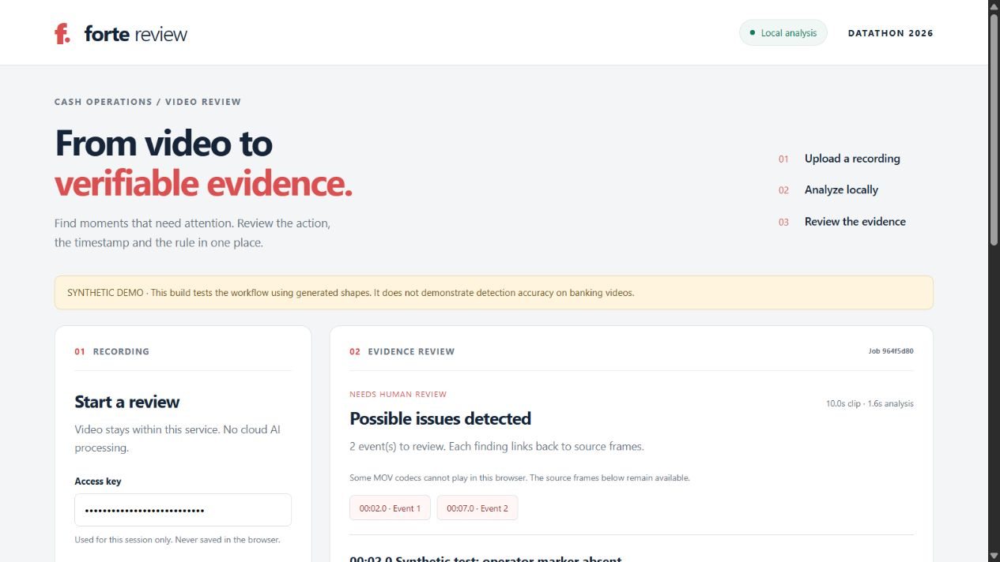

# Forte Review

A local video-review application for the ForteBank Datathon case. Upload a MOV file, poll the authenticated API, then inspect possible events with source frames, timestamps and a curated rule reference.

**Status:** the software includes a working synthetic end-to-end demonstration and a trainable CPU baseline. The Qwen GPU adapter is implemented but has not been executed on your RTX 4060. Event videos have not been provided in this workspace, so real detection accuracy, actual event coverage, GPU memory use and the five-minute limit on event data remain unmeasured. This is a runnable starting point, not a submission-ready trained detector.

## Team resources

- [Hackathon plan and balanced 12-hour schedule](HACKATHON_PLAN.md)
- [Backend and deployment instructions](team/YOU_BACKEND.md)
- [Ratmir: ML and evaluation instructions](team/RATMIR_ML.md)
- [Amir: frontend and presentation instructions](team/AMIR_FRONTEND.md)
- [Download the complete team kit ZIP](https://github.com/amoe6a/datathon2026_tumo-astana/raw/refs/heads/main/team-kit/forte-review-team-kit.zip)
- [Verification report and remaining checks](TEST_REPORT.md)

Clone this repository to work together, or download the ZIP for a standalone copy. The ZIP is the initial handoff snapshot and includes generated synthetic test clips; the repository contains their generator. Real event videos, runtime evidence and credentials are not included.



## Start here

1. Read `HACKATHON_PLAN.md` for priorities and the 12-hour schedule.
2. Give everyone this entire folder or the ZIP, then their corresponding file in `team/`.
3. You: `team/YOU_BACKEND.md`. Ratmir: `team/RATMIR_ML.md`. Amir: `team/AMIR_FRONTEND.md`.
4. Run the synthetic demo on each laptop. Download and label event videos locally on the RTX laptop. Never upload event footage, frames or descriptions to Codex/cloud AI.
5. Integrate a measured real-data detector by hour 5; deploy and freeze by hour 10.

## Windows quick start

Install Python 3.11 and Git. In PowerShell opened in this folder:

```powershell
py -3.11 -m venv .venv
.venv\Scripts\python.exe -m pip install -r requirements.txt
.venv\Scripts\python.exe -m scripts.make_demo
$env:FORTE_API_KEY = .venv\Scripts\python.exe -c "import secrets; print(secrets.token_urlsafe(24))"
$env:FORTE_ENGINE = 'demo'
$env:FORTE_MODEL = 'models/demo.npz'
Write-Host $env:FORTE_API_KEY
.venv\Scripts\python.exe -m uvicorn app.main:create_app --factory --host 127.0.0.1 --port 8000 --workers 1
```

Open `http://127.0.0.1:8000`, enter the generated key, and choose **Normal** or **Two events**. These buttons generate real API uploads of synthetic MOV clips. Keep the terminal running. `run.ps1` automates the same steps; it defaults to explicitly labeled demo mode. Python 3.11 is the tested runtime. No Node installation is needed.

For macOS/Linux: `python3.11 -m venv .venv`, `.venv/bin/python -m pip install -r requirements.txt`; use `export FORTE_API_KEY=...`, `export FORTE_ENGINE=demo`, `export FORTE_MODEL=models/demo.npz`, and `.venv/bin/python` in place of the Windows interpreter path.

## Real baseline on CPU

Copy `data.example.json` to `data/manifest.json`. Put videos in `data/videos/`. Human labelers add a category and time interval for each visible event; the organizer's binary label alone is not enough. Use only reviewed categories from `rules/catalog.json`. Explicitly label normal intervals. Unlabeled frames are ignored. Group related recordings before splitting; keep camera/actor/session duplicates together.

```powershell
.venv\Scripts\python.exe -m ml.train data/manifest.json --output models/reference.npz --threshold 0.8
.venv\Scripts\python.exe -m scripts.evaluate data/manifest.json --split val --output runtime/validation.json
$env:FORTE_ENGINE = 'reference'
$env:FORTE_MODEL = 'models/reference.npz'
```

Restart the server after changing its mode/model. The baseline uses small appearance, edge and motion features with a linear classifier. It is fast and useful as a measured comparator, but vulnerable to new camera angles and background shortcuts. Its scores are not calibrated probabilities. Synthetic weights are deliberately rejected in real reference mode.

## Local vision model on the RTX 4060 8 GB

The proposed candidate is **Qwen3-VL-2B-Instruct**, whose publisher lists Apache 2.0 licensing. Model weights are about 4.26 GB. Total memory depends on visual tokens, context and runtime overhead; 8 GB feasibility is an estimate to test, not a measured claim. Close other GPU workloads. Do not train or fine-tune a large model for the initial MVP.

On the RTX laptop, after core setup:

```powershell
.venv\Scripts\python.exe -m pip install torch==2.8.0 torchvision==0.23.0 --index-url https://download.pytorch.org/whl/cu126
.venv\Scripts\python.exe -m pip install -r requirements-gpu.txt
.venv\Scripts\python.exe -m scripts.doctor
.venv\Scripts\python.exe -m scripts.download_model
$env:FORTE_ENGINE = 'qwen'
$env:FORTE_MODEL = 'models/qwen3-vl-2b'
.venv\Scripts\python.exe -m uvicorn app.main:create_app --factory --host 127.0.0.1 --port 8000 --workers 1
```

Use a current NVIDIA driver compatible with the chosen CUDA wheel; the system CUDA toolkit is not required just to use the wheel. The pinned GPU combination is a proposed reproducible setup, not locally verified here. Verify imports and one 10-second clip before downloading/processing the full set. The model download pins a publisher revision. Retain its license. Runtime uses `local_files_only=True` and offline environment flags; there is no cloud inference endpoint.

The adapter covers the entire clip using overlapping 8-second windows, up to approximately nine 1-FPS images per window. It returns constrained event JSON; source IDs come only from the catalog. A malformed model response fails the job rather than becoming a clean verdict. Each API job starts a child process and reloads the model, so measure **cold end-to-end latency**, not just generation time. If this misses 240 seconds for a 145-second clip, reduce visual tokens/windows only after checking recall, or submit the validated reference baseline. GPU worker reuse is a later optimization.

## Jury API

`POST /api/v1/analyze` accepts multipart field `file` and returns HTTP 202 with `job_id` and `status: processing`. `GET /api/v1/jobs/{job_id}` returns `processing`, `done` or `failed`. Both require the same `X-API-Key`. Success returns exactly the required verdict values and required event fields; optional rule/meta fields support the UI.

```powershell
curl.exe -X POST http://127.0.0.1:8000/api/v1/analyze -H "X-API-Key: $env:FORTE_API_KEY" -F "file=@data/demo/multiple.mov"
curl.exe http://127.0.0.1:8000/api/v1/jobs/REPLACE_WITH_JOB_ID -H "X-API-Key: $env:FORTE_API_KEY"
.venv\Scripts\python.exe -m scripts.smoke_api data/demo/multiple.mov
```

One job at a time prevents GPU overload; a second submission gets HTTP 429 with `Retry-After`. Ask the organizers whether their harness retries 429 or sends concurrent videos. If concurrency is required, you own adding tested capacity or queueing with a deadline measured from acceptance. Never silently queue jobs beyond the five-minute budget. Run **one** Uvicorn worker; the in-process admission guard is not shared across multiple server processes.

Limits: 64 MB upload, 180 seconds, at most 4K resolution, 270-second worker timeout. Case videos are stated as about 29 MB and 10–145 seconds. Errors are `failed`, never `no_violation`. The binary verdict has no third `insufficient_data` option; uncertainty is attached as a review warning. A warning is not a substitute for a usable detector.

## Deployment and offline operation

Serve UI and API from the same machine. On the RTX laptop, a practical prototype route is a Cloudflare Tunnel pointing at `http://127.0.0.1:8000`. `cloudflared tunnel --url http://127.0.0.1:8000` prints a temporary HTTPS URL. A named tunnel is preferable for a stable address. A tunnel transports uploaded data; it is not an AI service. Confirm the organizer's interpretation of allowed network transport/hosting. If transport through third parties is disallowed, use a permitted directly reachable host and HTTPS reverse proxy instead. No tunnel was created or public URL registered in this delivery.

Keep the laptop plugged in, disable sleep through the normal settings, use a stable network, and test from another connection. Do not add a login screen ahead of the jury API. Provide the URL and key privately. Quick tunnels have no availability guarantee and the URL changes when recreated. Test the public endpoint at least twice before the deadline.

CPU container option: build with `docker build -t forte-review .`; run with the key in an environment variable, bind port 8000, and mount your trained model read-only at `/models` and writable runtime at `/runtime`. This Dockerfile is for the CPU reference engine; GPU deployment uses the RTX setup above or a separately tested CUDA image.

For the offline test, download dependencies and weights first, disconnect internet, and use the local UI/API. Rule links will not open offline, but their titles, sections, summaries and evidence remain available. Disable the external connection only on the test machine, then reconnect before jury access. Never rely on network APIs in the detector.

## Tests and data handling

```powershell
.venv\Scripts\python.exe -m pytest tests -q
.venv\Scripts\python.exe -m scripts.doctor
```

Raw uploads are deleted after each job. Evidence and metadata stay in `runtime/jobs.sqlite3` for review and are protected by the API key. Stop the server and delete your task's runtime/data directories after the event according to its retention rules. They are ignored by Git; do not commit them. There is no automatic retention timer yet. API access control uses a single shared jury key, not per-user authorization. There is no face identification, audio analysis, external font/CDN request or model telemetry in the application code.

## Known limitations

- The real detector is not evaluated until event data is downloaded and labeled. The enabled starting categories are hypotheses about dataset relevance.
- Two enabled event types are not an exhaustive taxonomy. New types can be missed. Extend the catalog only after checking visible evidence and a public RK rule.
- Sparse frames can miss brief actions. Absence-based rules are disabled until full action visibility and temporal coverage are demonstrated.
- A VLM can still misdescribe a frame. Schema validation prevents invented rule IDs, not visual hallucination. Human review remains necessary.
- The reference baseline cannot prove semantic actions and is sensitive to camera/background changes. Its explanation says it matched a pattern rather than inventing an action.
- Decoder timestamps use presentation timestamps where available with a nominal-FPS fallback; test rotation metadata, variable frame rate, actual MOV codecs and the new camera angle.
- JSON evidence is base64 and can be large. No batch jobs, account system, face recognition, chatbot or analytics dashboard is included.

See `SOURCES.md` for the case/guide distinctions, model licensing, official regulation and deployment references.
